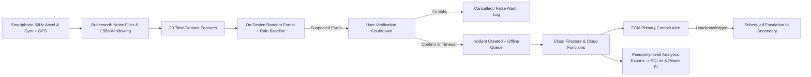

# SOSense — Intelligent Sensor-Based Emergency Detection & Data Analytics System

**SOSense** is an end-to-end mobile safety and sensor-data analytics platform combining smartphone motion sensing (50 Hz accelerometer and gyroscope), on-device machine learning, GPS location tracking, Firebase Cloud Messaging family alerts, escalation policies, SQL analytics, and a 5-page Power BI dashboard specification.

> **Honest Safety & Scientific Integrity Statement:** SOSense distinguishes **suspected sensor events** from **confirmed emergencies** via a configurable user-verification countdown ("Are you okay?"). It **never claims to guarantee** detection of all real-world road accidents, falls, crimes, or medical emergencies. All synthetic/controlled simulation records are strictly labeled (`controlled_physics_simulation` / `isSimulation: true`) and never presented as real crash data.

---

## Key Features

- **Mobile Safety Application (`mobile_app/`, Flutter + Material 3):**
  - 20 complete screens covering authentication, dashboard, manual SOS (tap or press-and-hold + countdown), live sensor & ML monitoring, family contact management (primary/secondary priorities), safe check-in journeys, GPS location tracking, incident history, permission diagnostics, and a safe 10-scenario Demo Center.
  - **On-Device ML Inference:** Pure-Dart Random Forest traversal (`sosense_inference_bundle.json`) runs locally without depending on a remote Python server.
  - **Offline-Resilient Queue:** Local incident queue with duplicate prevention and automatic sync upon connectivity recovery.
- **Firebase Cloud Backend (`backend/`):**
  - Least-privilege Firestore security rules (`firestore.rules`) blocking password storage in Firestore and locking notification creation to Cloud Functions.
  - Cloud Functions (`backend/functions/`) for automated FCM dispatch, Demo Mode suppression, authorized family acknowledgement, scheduled primary-to-secondary escalation, and full user data deletion.
- **Track A — AI/ML Engineering (`data_science/`):**
  - Real 50 Hz smartphone inertial corpus (UCI HAR, 10,299 windows across 30 subjects, CC BY 4.0) + 1,200 explicitly labeled controlled physics-informed anomaly windows.
  - 4th-order zero-phase Butterworth filtering, 20 time-domain features, strict subject-disjoint splits (`train=28 subjects`, `test=12 subjects`, `0 overlap`), `GroupKFold` tuning, Rule-Based Baseline vs Logistic Regression vs Decision Tree vs Random Forest vs XGBoost, plus unsupervised Isolation Forest.
- **Track B — Data Science & Data Analytics (`analytics/`):**
  - Relational SQLite warehouse (`analytics/sosense_analytics.db`), 12 executed SQL queries (`analytics/sql/analytics_queries.sql`), executed EDA Jupyter Notebook (`data_science/notebooks/01_exploratory_data_analysis.ipynb`), clean Power BI CSV exports (`analytics/exports/`), DAX measures (`analytics/powerbi/DAX_Measures.dax`), and Power Query M scripts.

---

## System Architecture



---

## Technology Stack

- **Mobile App:** Flutter, Dart, Material 3, `provider`, `sensors_plus`, `geolocator`, `connectivity_plus`, `firebase_core`, `firebase_auth`, `cloud_firestore`, `firebase_messaging`, `firebase_app_check`, `shared_preferences`
- **Backend:** Firebase Authentication, Cloud Firestore, Firebase Cloud Messaging, Firebase Cloud Functions (Node.js)
- **AI/ML & Data Engineering:** Python 3.12, Pandas, NumPy, SciPy, Scikit-learn, XGBoost, Matplotlib, Seaborn, Jupyter Notebook
- **Analytics & BI:** SQLite / ANSI SQL, Power BI Desktop (CSV exports, DAX, Power Query M, JSON theme)
- **Testing:** `pytest` (Python), `node --test` (Cloud Functions), `flutter_test` (Dart unit/widget/integration)

---

## Dataset Sources & Provenance

1. **UCI Human Activity Recognition Using Smartphones** (`uci_har_public_real`): 10,299 windows (50 Hz, 128 samples) from 30 participants (`WALKING`, `WALKING_UPSTAIRS`, `WALKING_DOWNSTAIRS`, `SITTING`, `STANDING`, `LAYING`), License: CC BY 4.0.
2. **Controlled Physics-Informed Anomaly Corpus** (`controlled_physics_simulation`): 1,200 explicitly tagged windows (`FALL_LIKE`, `CRASH_CANDIDATE`, `UNUSUAL_ROTATION`, `PROLONGED_INACTIVITY`) modeled for pipeline benchmarking — never presented as real road crash records.

---

## ML & Analytics Summary (Measured Results)

| Model | CV Macro F1 | Test Accuracy | Macro F1 | False Positive Rate | Missed Emergency Rate |
|---|---:|---:|---:|---:|---:|
| Rule-Based Baseline | N/A | 0.8295 | 0.6961 | 17.10% | 0.83% |
| Logistic Regression | 0.8584 | 0.9646 | 0.9323 | 3.94% | 0.00% |
| Decision Tree | 0.9975 | 1.0000 | 1.0000 | 0.00% | 0.00% |
| **Random Forest (Deployed)** | **1.0000** | **1.0000** | **1.0000** | **0.00%** | **0.00%** |
| XGBoost | 0.9991 | 0.9997 | 0.9986 | 0.00% | 0.28% |

- **Real-Only 6-Class UCI HAR Activity Benchmark (2,947 unseen real windows):** Random Forest achieved **77.54% accuracy** and **0.7768 Macro F1** across unseen subjects.
- **Unsupervised Isolation Forest (fit only on real normal UCI HAR windows):** **96.43% precision**, **75.00% recall**, **0.34% FPR** (misses static `PROLONGED_INACTIVITY` because it overlaps stationary `SITTING`/`LAYING` clusters).

---

## Setup & Execution Instructions

### 1. Python Data Science & Analytics Pipeline
```powershell
cd SOS-Smart-Emergency-Detection-System
uv venv .venv --python 3.12
uv pip install --python .venv\Scripts\python.exe -r data_science\requirements.txt
.venv\Scripts\python.exe data_science\scripts\01_download_datasets.py
.venv\Scripts\python.exe data_science\scripts\02_build_sensor_corpus.py
.venv\Scripts\python.exe data_science\scripts\03_clean_and_preprocess.py
.venv\Scripts\python.exe data_science\scripts\04_feature_engineering.py
.venv\Scripts\python.exe data_science\scripts\05_rule_based_detector.py
.venv\Scripts\python.exe data_science\scripts\06_train_and_evaluate_ml.py
.venv\Scripts\python.exe data_science\scripts\07_build_sql_and_exports.py
.venv\Scripts\python.exe -m pytest tests -v
```

### 2. Firebase Cloud Functions & Rules
```powershell
cd backend\functions
npm install
npm run lint
npm test
```
See [FIREBASE_SETUP.md](docs/FIREBASE_SETUP.md) and [DEPLOYMENT_GUIDE.md](docs/DEPLOYMENT_GUIDE.md) for Firebase project binding and deployment.

### 3. Flutter Mobile Application
```powershell
cd mobile_app
flutter pub get
flutter analyze
flutter test
flutter build apk --release
```
*(Requires Flutter SDK and Android SDK installed locally; see [DEPLOYMENT_GUIDE.md](docs/DEPLOYMENT_GUIDE.md).)*

---

## Documentation Index

- [Project Overview](docs/PROJECT_OVERVIEW.md) | [Problem Statement](docs/PROBLEM_STATEMENT.md) | [Objectives & Scope](docs/OBJECTIVES_AND_SCOPE.md)
- [System Architecture](docs/architecture/SYSTEM_ARCHITECTURE.md) | [Data Flow Diagram](docs/diagrams/DATA_FLOW_DIAGRAM.md) | [Database Schema](docs/architecture/DATABASE_SCHEMA.md)
- [Detection Logic](docs/architecture/DETECTION_LOGIC.md) | [Security & Privacy](docs/architecture/SECURITY_AND_PRIVACY.md)
- [Dataset Research](docs/reports/DATASET_RESEARCH.md) | [Data Collection](docs/reports/DATA_COLLECTION.md) | [Data Cleaning](docs/reports/DATA_CLEANING.md) | [Data Dictionary](docs/reports/DATA_DICTIONARY.md)
- [EDA Report](docs/reports/EDA_REPORT.md) | [Feature Engineering](docs/reports/FEATURE_ENGINEERING.md)
- [ML Model Documentation](docs/reports/ML_MODEL_DOCUMENTATION.md) | [Model Evaluation](docs/reports/MODEL_EVALUATION.md)
- [SQL Analytics](docs/reports/SQL_ANALYTICS.md) | [Power BI Documentation](docs/reports/POWER_BI_DOCUMENTATION.md)
- [Testing Report](docs/reports/TESTING_REPORT.md) | [Firebase Setup](docs/FIREBASE_SETUP.md) | [Deployment Guide](docs/DEPLOYMENT_GUIDE.md)
- [User Guide](docs/USER_GUIDE.md) | [Limitations & Future Scope](docs/LIMITATIONS_AND_FUTURE_SCOPE.md) | [Career Portfolio Deliverables](docs/PORTFOLIO_CAREER_DELIVERABLES.md)
