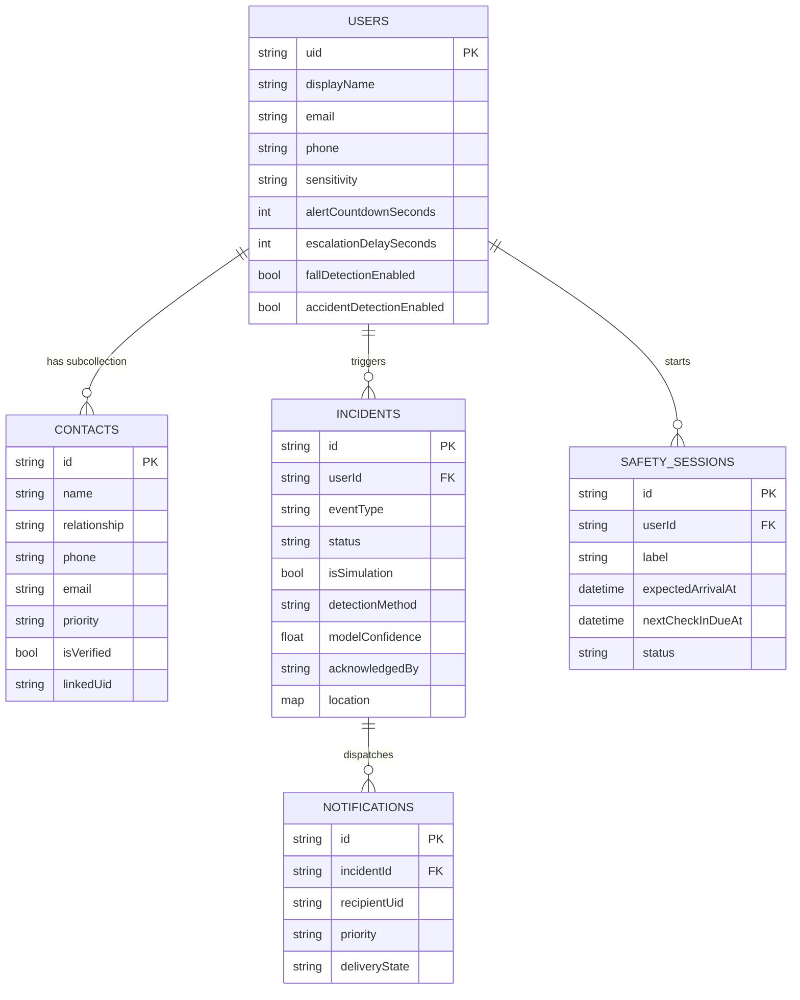

# Database Architecture & Schema

SOSense uses **Cloud Firestore** as the real-time operational backend and **SQLite (`analytics/sosense_analytics.db`)** as the structured relational analytics layer.

## 1. Cloud Firestore Entity-Relationship Diagram

## 2. SQLite Relational Analytics Tables (`analytics/sosense_analytics.db`)
- `sensor_events` (11,499 rows): Full window metadata, provenance (`data_source`), 20 engineered features, and held-out model predictions.
- `incident_logs` (440 evaluation simulation rows): Pseudonymized `user_hash`, `event_type`, `status`, `ack_latency_seconds`, `escalation_triggered`, `is_false_alarm`, `is_simulation = 1`.
- `notifications_log` (419 evaluation simulation rows): Recipient priority, channel, acknowledgement flag, response latency.
- `test_predictions` (3,307 rows): Subject-disjoint test predictions across Rule Baseline, Logistic Regression, Decision Tree, Random Forest, XGBoost, and Isolation Forest.
- `ml_model_metrics` & `ml_confusion_matrix`: Aggregated model evaluation metrics.
