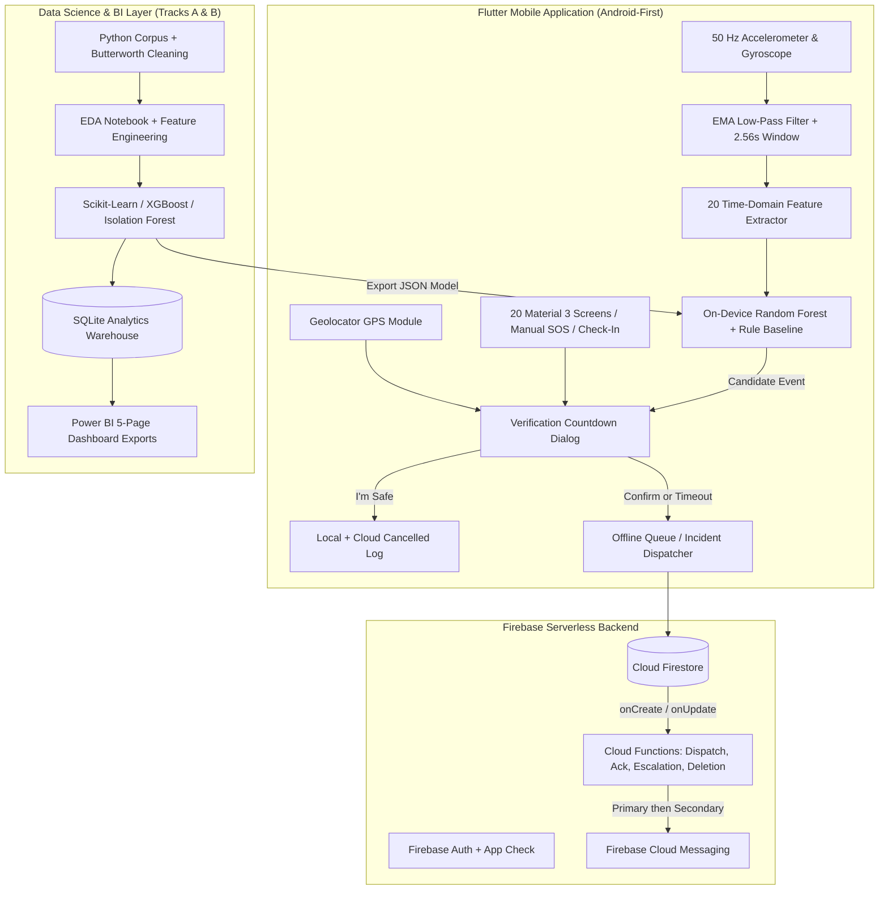
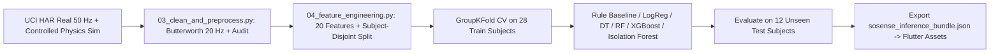
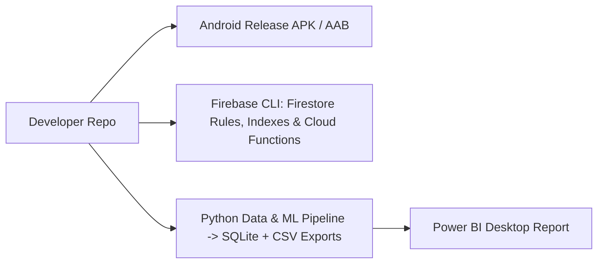

# System Architecture

SOSense uses a decoupled modular architecture separating mobile sensing/on-device inference, serverless Firebase dispatch/escalation, and offline Python/SQL/Power BI analytics.

## 1. High-Level System Architecture (Input → Processing → Output)

## 2. ML Training & Inference Workflow

## 3. Deployment Architecture

